<!-- fait par Ouibel.com -->

  
  
  
  

## 👋 Bonjour, je suis Jordan

Développeur indépendant et cofondateur de **[Ouibel](https://ouibel.com)**, un studio belge qui crée des solutions numériques complètes pour les indépendants, les commerces et les PME : du site vitrine à l’application métier, jusqu’au suivi après la mise en ligne.

J’ai d’abord connu le terrain, celui des commerçants et des entrepreneurs. C’est ce qui guide ma façon de travailler : **des outils simples à utiliser, rapides, fiables, et qui font gagner du temps au quotidien.**

Ce que j’apporte : **un seul interlocuteur pour tout le projet**, du design jusqu’à la mise en ligne, avec du code propre et sécurisé.

## 🧭 Ce que je construis

| | Domaine | En pratique |
|---|---|---|
| 🌐 | **[Création de sites web](https://ouibel.com/services/creation-site-web/)** | Sites vitrines rapides, multilingues, optimisés pour Google, avec un éditeur visuel pour les modifier soi-même. |
| 🧾 | **[Logiciels de gestion sur mesure](https://ouibel.com/services/application-web-sur-mesure/)** | Facturation, devis, comptabilité, TVA belge, factures électroniques Peppol, espaces clients, signature et paiement de documents. |
| 🏭 | **Logiciels métier (ERP)** | Outils sur mesure pour l’atelier, la production et le suivi des commandes, sur PC et sur téléphone. |
| 📱 | **[Applications mobiles](https://ouibel.com/services/application-mobile/)** | Android (Kotlin) et iOS, reliées en temps réel au logiciel du bureau. |
| 🛒 | **[Boutiques en ligne](https://ouibel.com/services/boutique-en-ligne/)** | Vente en ligne, abonnements, paiements sécurisés. |
| 💶 | **[Caisse enregistreuse](https://ouibel.com/services/caisse-enregistreuse/)** | Logiciel de caisse avec balances connectées et impression de tickets. |
| 🛡 | **[Mise en ligne et maintenance](https://ouibel.com/services/)** | Mise en ligne, mises à jour et suivi de vos sites et applications. |
| ✨ | **Intelligence artificielle** | Assistants IA intégrés aux outils métier, automatisation, analyse de documents. |

## 🚀 Projets réalisés

> Mes projets sont privés : je décris ici le travail réalisé, sans le code ni le nom des clients.

- **ERP industriel multiplateforme** : logiciel PC (React), application Android (Kotlin) et API (NestJS) synchronisés, avec tests de bout en bout.
- **Logiciel de caisse professionnel** : balances connectées, impression de tickets, application de bureau.
- **Facturation pour l’HORECA** : scan d’articles au téléphone → facture en direct sur le PC, gestion du stock et des dates de péremption.
- **Plateforme de jeux en ligne** : panel client, sous-utilisateurs, éditeur de fichiers, support par tickets.
- **Espaces clients** : documents à payer et à signer en ligne, abonnements, suivi des envois et relances automatiques.
- **Sites vitrines et associatifs** : éditeur visuel complet, gestion des rôles, pages légales générées automatiquement.
- **Navigateur web Ouibel** : navigateur macOS en Swift/WebKit avec bouclier anti-pub de 78 000 domaines, coffre de mots de passe chiffré, traduction et assistant IA intégré.

## 🛠 Technologies

**Front-end**
 

**Back-end**
 

**Mobile et bureau**
 

**Outils**
 

## 🔒 Ma façon de travailler

- **Sécurité dès la conception** : la protection des données est pensée dès le départ.
- **Qualité vérifiée** : tests automatisés et compilation continue avant chaque mise en ligne.
- **Performance et référencement** : pages rapides, structurées pour Google, en plusieurs langues.
- **Sur mesure** : chaque outil est pensé pour le métier du client, pas l’inverse.
- **Proximité** : un studio belge, joignable, qui parle le langage des entrepreneurs, du premier échange jusqu’après la mise en ligne.

## 📬 Travaillons ensemble

Un projet, une idée, un outil à moderniser ? Parlons-en.

👉 **[Demander un devis gratuit sur ouibel.com](https://ouibel.com/contact/)**

Création de site internet en Belgique · application web et mobile sur mesure · logiciel de caisse — <a href="https://ouibel.com">Ouibel</a>

